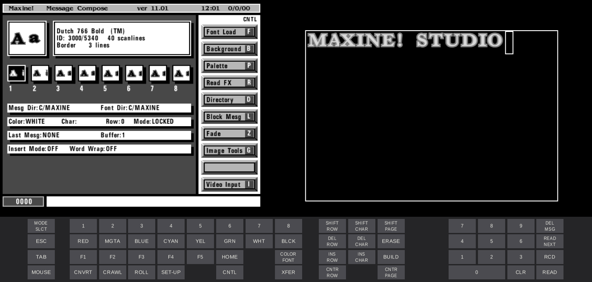
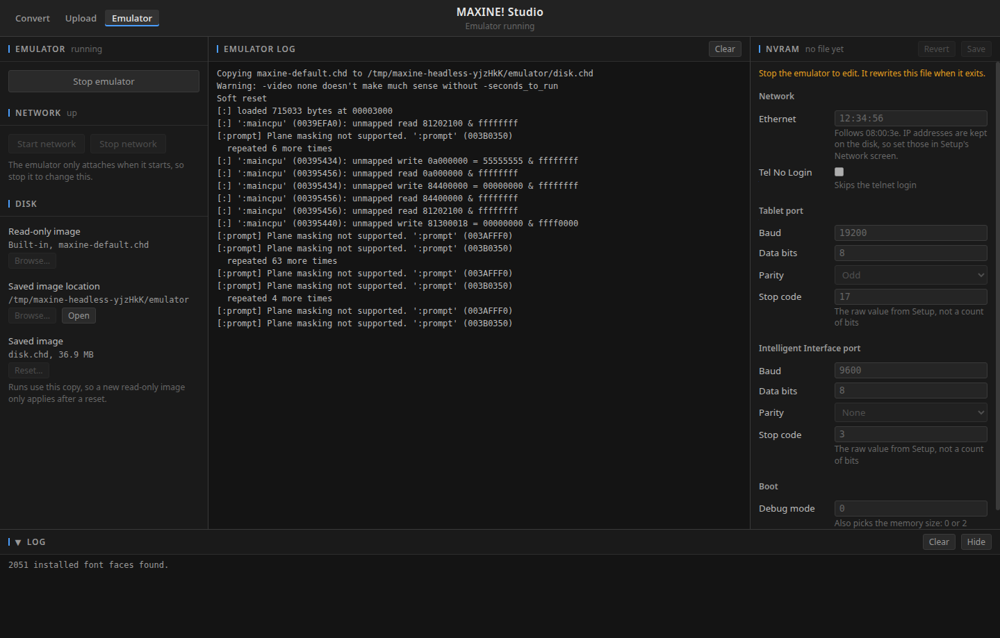

# MAXINE! Studio

A desktop app that converts fonts for the Chyron MAXINE! and other iNFiNiT! series character generators, and a full emulator of a MAXINE! based on MAME.




## Preview a font

Choose any font installed on your computer, or drop in a TTF, OTF or TTC file. 


## Convert it

Set the size, and add a border or a border with a drop shadow. The result appears next
to the original. The edge shows in red.

To make a set of sizes, like the original MAXINE! bitmap fonts, choose how many sizes to
add above and below yours, and the amount of scanlines to increment/decrement.


## Send it to the MAXINE!

Connect to the unit over FTP to upload fonts.
Fonts are grouped by typeface, with a twirl-down to show every size. Each is marked
when it's on the unit. 


## Run the emulator

The emulator is built into the app. On the Emulator tab, press Run and it opens in its own window. Start the
network first to reach it over FTP at 10.37.0.2.

The Capture section records Video and Key live, as a matched pair of 59.94i ProRes files.



Keys and details are in [emulator/README.md](emulator/README.md).

## Get the app

[Download the latest release](https://github.com/jdanna/MaxineStudio/releases/latest) for Apple
Silicon Macs, Windows or Linux. Builds aren't signed, so your system may warn you or refuse to open
the app at first.

To build it yourself, install [Node.js](https://nodejs.org) and run one of these. The
installer lands in `dist/`.

```sh
npm install
npm run predist:mac   # or predist:win, predist:linux
npm run dist:mac      # or dist:win, dist:linux
```

`predist` fetches Python and builds the emulator, which uses Docker for Linux and Windows.

## More

The file format and research notes are in [CLAUDE.md](CLAUDE.md), the test plan is in
[experiments/MANIFEST.md](experiments/MANIFEST.md), and the command-line tools are in
[tools/](tools/).

This is an independent preservation project, not affiliated with Chyron.
