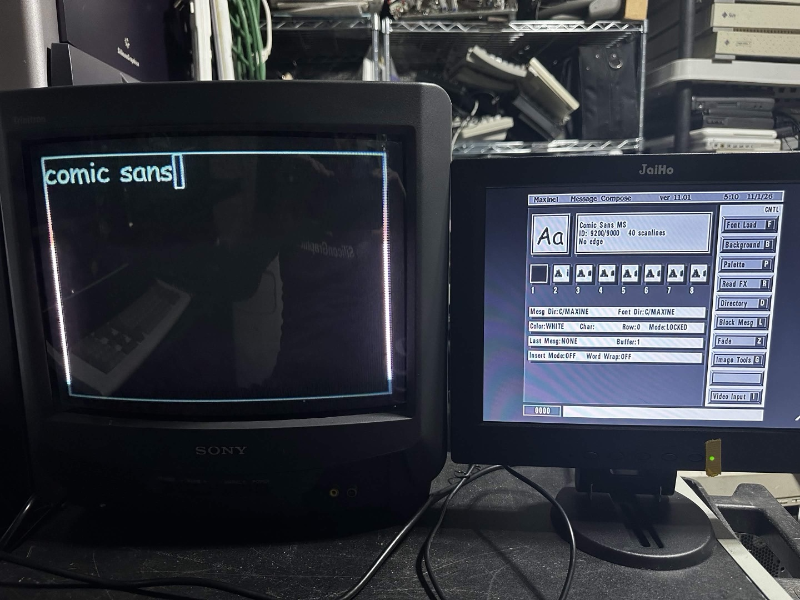
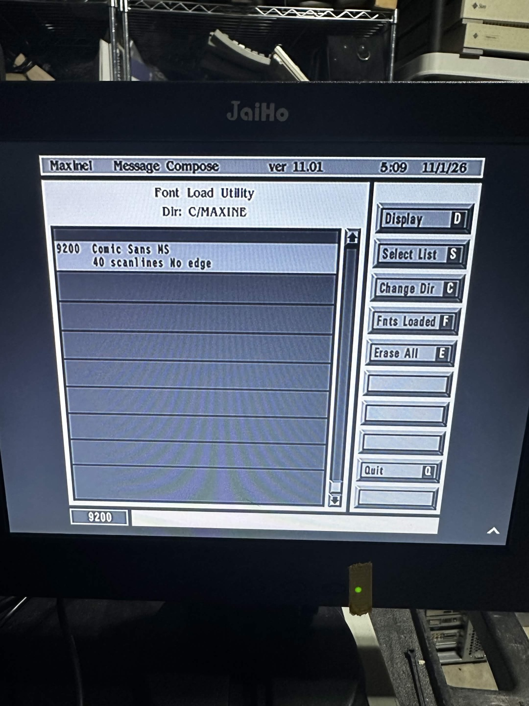
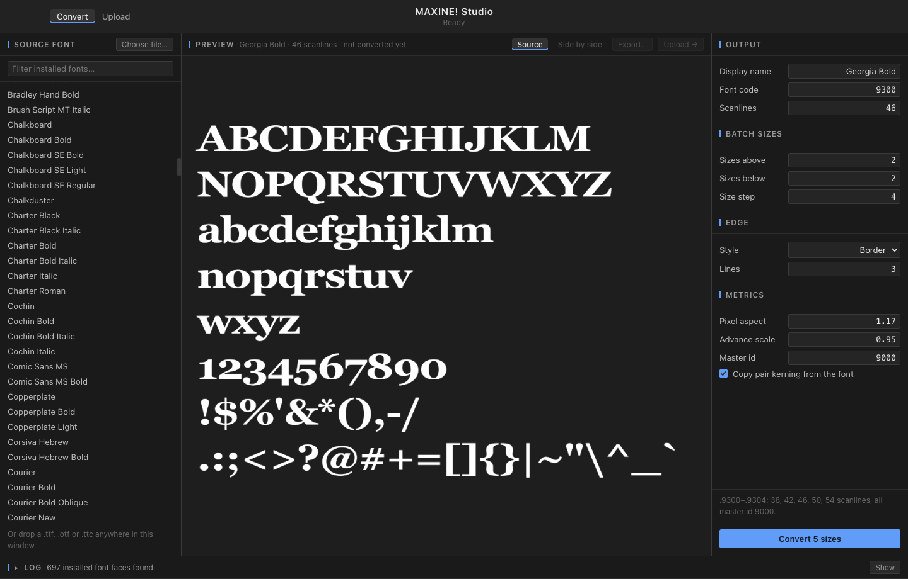
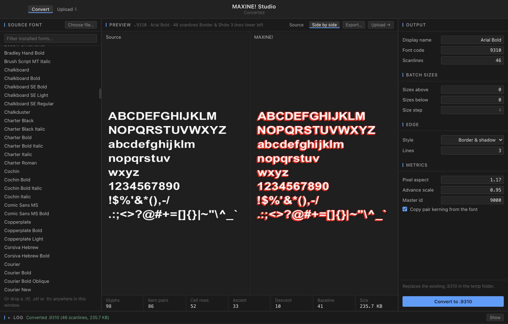
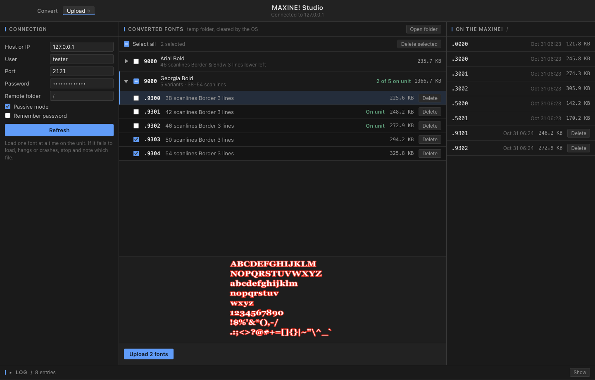

# MAXINE! Studio

A desktop app that turns modern fonts into fonts for the Chyron MAXINE!, a vintage
broadcast character generator, so these systems can keep working with new typefaces.

Pick a font, see how it will look, convert it, and send it to the unit.

Here's Comic Sans, converted with this app, running on a real unit:





## Preview a font

Choose any font installed on your computer, or drop in a TTF, OTF or TTC file. You see
it right away at your size and spacing, before converting anything.



## Convert it

Set the size, and add a border or a border with a drop shadow. The result appears next
to the original at the same scale, so you can see what changed. The edge shows in red.

To make a set of sizes, like the original MAXINE! fonts have, choose how many sizes to
add above and below yours.



## Send it to the MAXINE!

Connect to the unit over FTP to see what's on it, then upload one font or a whole batch.
Fonts are grouped by typeface, with a twirl-down to show every size. Each one is marked
when it's on the unit. Only test fonts can be deleted from the unit, so the originals are
safe, and the app asks before replacing a font.



## Get the app

There are no downloads yet, so you'll need to build it. MAXINE! Studio runs on Mac,
Windows and Linux. With [Node.js](https://nodejs.org) installed, run one of these:

```sh
npm install
npm run dist:mac      # or dist:win, dist:linux
```

The installer lands in `dist/`. Builds aren't signed, so your system may warn you or
refuse to open the app at first.

## More

The file format and research notes are in [CLAUDE.md](CLAUDE.md), the test plan is in
[experiments/MANIFEST.md](experiments/MANIFEST.md), and the command-line tools are in
[tools/](tools/).

This is an independent preservation project, not affiliated with Chyron.
