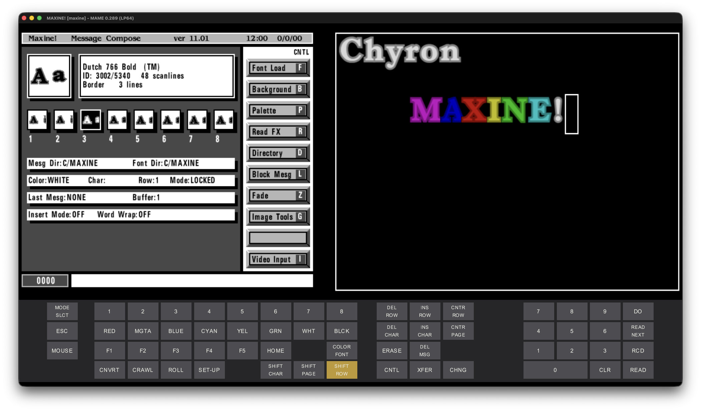

# MAXINE! emulator



A MAME driver that runs the Chyron MAXINE! 11.01 software. Prompts is on the left, Color Edit on the
right, and a clickable panel of MAXINE! keys is below them.

## Functionality

- Runs from the original disk
- Message compose and other built-in apps fully work.
- Exports Fill and Key as PNGs.
- Emulates a mouse and a WACOM SD510C tablet.
- Includes 64 MB of expansion RAM.

## Instructions

Needs Xcode command line tools, Python 3 and SDL2 (`brew install sdl2`). The first build takes a long time.

```bash
emulator/build.sh
emulator/run.sh
```

The firmware runs on `emulator/run/disk.chd`, copied from `roms/maxine-default.chd` on first launch, so
your work is kept. Delete that file to start over. The default has software options enabled, and
`roms/maxine-v11.01.chd` is the clean [archive.org](https://archive.org/details/maxine-v10v11) image.

### Keys

| Host | MAXINE |
|---|---|
| Return | NEW LINE |
| Backspace | BACKSPACE |
| Left Ctrl | CNTL |
| Left Alt | ALT |
| Esc | ESC |
| Arrows | CURSOR |
| Home | HOME |
| Page Up | READ |
| Page Down | CHNG |
| End | READ NEXT |
| Insert | XFER |
| F1–F10 | F1–F10 |
| F11, F12 | CRAWL, ROLL |
| Numeric keypad | KEYPAD |
| Fn+Delete | ERASE, which clears the whole message |

Everything else is on the panel. Its SHIFT keys stay latched until clicked again and apply to the arrow
keys, and holding the host's Shift moves further. MODE SLCT opens the menu that exits to the Loader.

Command-V pastes the clipboard as plain ASCII.

### Mouse

The mouse isn't captured. Over Prompts, the firmware's arrow follows your pointer and the buttons click
there. It re-syncs when the pointer re-enters Prompts or the app regains focus.

### Tablet

Choose WACOM SD510C under Tablet Type in the Loader's Setup, then click MOUSE on the panel to switch to
TABLET. It only works in Logo Compose. Left and right click are buttons 1 and 2. Button 2 flips between the
crosshair on Color Edit and the arrow on Prompts, so keep your pointer over the screen in use.

To draw an outline over Color Edit, press O, Return, Right arrow, Return, then P at each point and O to
close it. Press `?` in Logo Compose for the other keys.

### Export

On a Mac, use Export > Video and Key in the menu bar, or Command-E, and choose a folder. Right Ctrl saves to
`emulator/run/snap/maxine/` instead. Each export writes 720×486 `video` and `key` PNGs, plus `-square` copies
at 648×486 for square-pixel tools.

## Limitations

- Only tested on macOS.
- Networking doesn't work.
- No boot PROM dump: the driver loads the operating system from disk itself.
- The edge colour, Prompts palette, Logo Compose outline colour and 50 MHz CPU speed are guesses.
- The clock and date can read wrongly.
- Fn+Delete also switches to MAME's controls, and pressing it again switches back. In that mode Esc can quit.
